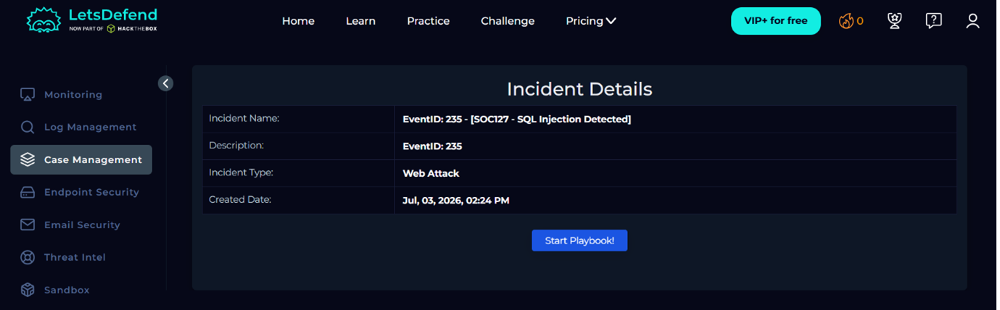
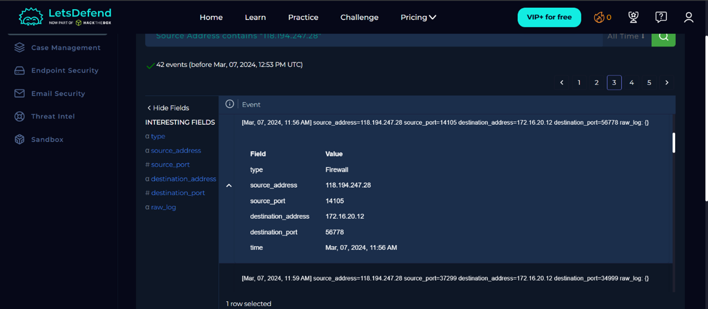
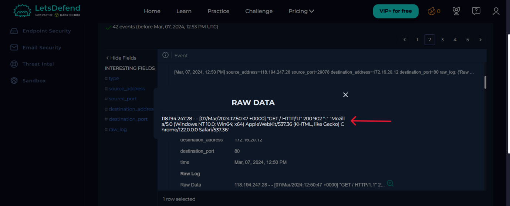

# Incident Report: SQL Injection Detected (SOC127)

## 1. Header

| Field | Value | 
| ----- | ----- | 
| **Alert ID** | 235 | 
| **Alert Name** | SOC127 - SQL Injection Detected | 
| **Triggered (UTC)** | March 07, 2024, 12:51 PM | 
| **Analyst** | Matsenjwa Misumuzi | 
| **Severity** | High | 
| **Final Verdict** | True Positive | 
| **Status** | Closed | 

## 2. Executive Summary

On March 7th, 2024 at 12:51 PM, an alert was triggered by the detection of an SQL injection targeting the web application hosted on the IP address `172.16.20.12`. Upon investigation, it was found that the IP address `118.194.247[.]28` attempted to inject SQL injection payloads on the web server. After the investigation, the available logs do not indicate successful exploitation.

## 3. Alert Details

| Attribute | Value | 
| ----- | ----- | 
| **Detection Rule** | SOC127 - SQL Injection Detected | 
| **Recipient** | WebServer1000 | 
| **Recipient IP Address** | 172.16.20.12 | 
| **Sender IP Address** | 118.194.247\[.\]28 | 

## 4. Investigation and Triage

I started my investigation in the Endpoint security tab where I found no records for the day of the incident. I then moved my search to the email security tab where I found no emails around that date. After that, I moved to the log management tab where I first filtered the logs using the destination IP address and found one log corresponding to the time of the incident which was for an update. I then filtered the logs using the sender IP address.

I found that the IP address `118.194.247[.]28` had scanned multiple ports on the web server until they found port 80 open as shown in Figure 2. The attacker subsequently attempted multiple SQL injection payloads in order to gather information about the database. After investigating all the GET requests sent to the web server, it was found that the attacker first used a web browser to determine that the web server was reachable as shown in Figure 3. The same IP address then switched to using SQLmap which is an automated attack tool as illustrated in Figure 4.

The attacker started testing multiple injection techniques as shown in Figure 5, then fingerprinting the database using multiple SQLi queries for different Database Management Systems (DBMSs), attempted different SQL injections styles (boolean, error-based, time-based) for different DBMSs, and schema enumeration using the key word "ORDER BY". This activity is indicative of an SQL injection reconnaissance and attempted exploitation meaning that the attacker was attempting to determine how queries are processed and what type of DBMS is being used.

I then conducted threat intelligence on the sender's IP address and found that the sender IP address has a malicious reputation, originates from China and has been flagged by 10/91 security vendors as stated by VirusTotal as shown in Figure 6, checked 7 July 2026. The IP address was also found by AbuseIPDB to be malicious and have been linked to multiple web attacks and Brute-Force attacks as shown in Figure 7, checked 7 July 2026.

Based on the available logs, there is no evidence to suggest the attack was successful. After the investigation, the affected host was contained to reduce exposure, and the alert was escalated for further analysis. I also recommend that the malicious IP address be blacklisted so any future attempts from this IP address can be recognized and denied.

## 5. Threat Intelligence

* **Sender IP:** `118.194.247[.]28`

* **Assessment:** The sender IP has a history of malicious activity according to VirusTotal and AbuseIPDB.

## 6. Timeline

| Time | Event | 
| ----- | ----- | 
| **12:51 PM** | Alert raised | 
| **1:00 PM** | Analyst takes over; triage begins | 
| **1:48 PM** | Verdict: True Positive; indicator submitted for blocking; device contained | 

## 7. Indicators of Compromise

| Type | Indicator | Context | 
| ----- | ----- | ----- | 
| **IPv4 address** | `118.194.247.28` | Sender IP address | 

### 7.1 STIX 2.1 Indicator

{
  "type": "indicator",
  "spec_version": "2.1",
  "id": "indicator--727a1232-6855-4b5b-a25e-7cc92ef6ddf2",
  "created": "2026-07-03T21:23:00.000Z",
  "modified": "2026-07-03T21:23:00.000Z",
  "name": "SQL injection IP Address",
  "description": "known web attack and brute force IP address",
  "indicator_types": ["malicious-activity"],
  "pattern": "[ipv4-addr = '118.194.247.28']",
  "pattern_type": "stix",
  "valid_from": "2026-07-03T21:26:13.000Z"
}

## 8. MITRE ATT&CK Mapping

| Tactic | Technique | ID | 
| ----- | ----- | ----- | 
| **Initial Access** | Exploiting public-facing application | T1190 | 
| **Reconnaissance** | Active scanning | T1595 | 
| **Discovery** | Software discovery | T1518 | 

## 9. Impact and Containment

After the investigation, it is evident that an attacker attempted to inject malicious SQL queries in order to identify the DBMS in use, reveal the behavior of the DBMS to different SQL queries as well as retrieve confidential information through the tool SQLmap. This tool is an automated tool used to identify and exploit SQL injection vulnerabilities. The web server was able to process the queries and provided responses to the attacker but there is no evidence to suggest that the SQL injection attack was a success.

I contained the web server to prevent further compromise and escalated the alert for further analysis. I also recommend the malicious IP address be blacklisted to prevent any further malicious activity from it.

## 10. Conclusion and Recommendations

The investigation determined that the alert is a True Positive for SQL injection payloads for the `WebServer1000` as there was evidence of malicious queries used by the IP address `118.194.247[.]28`. The logs suggest that the attacker was conducting a reconnaissance mission to determine the DBMS used by the web server, the behavior of the DBMS to different queries, and an attempt to extract confidential data from the DBMS. There is no confirmed data exfiltration. Based on the evidence, this was a database fingerprinting expedition.

I recommend that input validation and sanitization be implemented to ensure that data is valid and safe for processing. I also recommend that the WAF be updated and patched as soon as updates are available to minimize the attack surface.

## 11. Evidence

**Figure 1:** A screenshot of the alert details.  

**Figure 2:** A screenshot of the attacker trying to find an open port for the attack.  

**Figure 3:** A screenshot of a log showing the attacker initially used a web browser.  

**Figure 4:** A screenshot of a log showing the attacker using SQLmap.  

**Figure 5:** A screenshot of a log showing one of the queries sent by the attacker to the web server.  

**Figure 6:** A screenshot of the search results for the malicious IP address on VirusTotal.  

**Figure 7:** A screenshot of the search results for the malicious IP address on AbuseIPDB.  

**Figure 8:** A screenshot of the closed alert.  

