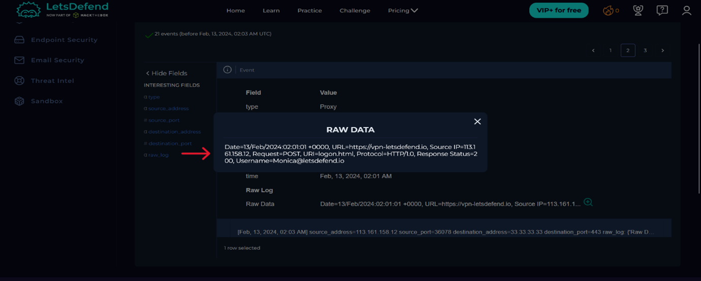
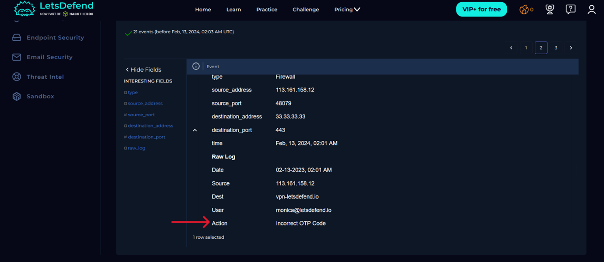
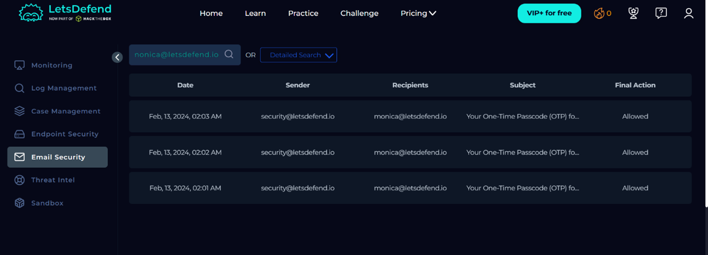
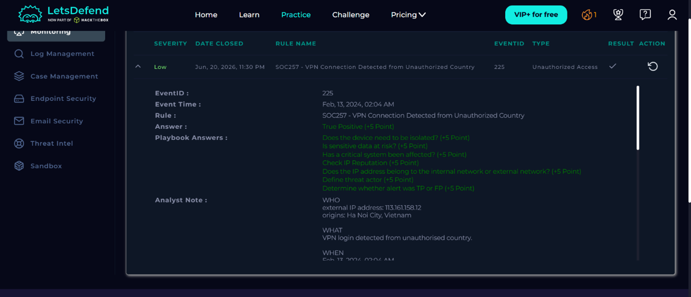

# Incident Report: SOC257 - VPN Connection Detected from Unauthorized Country (SOC257)

## 1. Header

| Field | Value | 
| ----- | ----- | 
| **Alert ID** | 255 | 
| **Alert Name** | SOC257 - VPN Connection Detected from Unauthorized Country | 
| **Triggered (UTC)** | Feb, 13, 2024, 02:04 AM | 
| **Analyst** | Matsenjwa Misumuzi | 
| **Severity** | Low | 
| **Final verdict** | True positive | 
| **Status** | Closed | 

## 2. Executive Summary

On February 13 2024 at 02:04, an alert was triggered by a VPN connection attempt from an unauthorized location. The IP address `113.161.158[.]12` located in Vietnam attempted to connect to the VPN using an internal user’s credentials. The IP address tried multiple times to gain access to the VPN but failed due to incorrect MFA OTP codes entered. Atypical terminal commands were also observed on the hostname: Monica’s terminal history.

## 3. Alert Details

| Attribute | Value | 
| ----- | ----- | 
| **Detection rule** | SOC257 - VPN Connection Detected from Unauthorized Country | 
| **Recipient** | IP address: `33.33.33.33` | 
| **Sender** | `113.161.158[.]12` | 
| **Subject** | N/A | 
| **Attachment** | N/A | 
| **Embedded URL** | `https://vpn-letsdefend.io` | 
| **Sender IP** | `113.161.158[.]12` | 

## 4. Investigation and Triage

Since this was an VPN connection detected from an unauthorized country, the first place I looked at was the Log management tab and filtered them using the source IP address `113.161.158[.]12` to see what activities were recorded. I found that a total of three VPN connections were attempted using the user Monica’s credentials and a total of two failed attempts due to incorrect MFA code inputs. Figure 3 shows one of the failed MFA OTP codes.

object:image{name=Figure3.png}

From there, I went to Email security tab and accessed the Monica’s device to see its activity. I found that a total of three MFA codes were emailed to this user as shown in Figure 5. 

object:image{name=Figure5.png}

A sample of one of the emails sent to the user Monica’s email address is shown in Figure 7.

object:image{name=Figure7.png}

Since the user Monica received the three emails from the security team with the MFA codes and there is no evidence to suggest she might be working from Vietnam, it is likely that the user’s credentials have been compromised. Then I investigated the terminal history and found that there were a number of command inputs starting from `2024-02-13 08:00` to `2024-02-13 10:45` at EXACTLY 15-minute intervals as shown in Figure 8. 

object:image{name=Figure8.png}

This is atypical behaviour of an employee and must be investigated further.

After finding out this information, I then conducted a threat analysis on the source IP address, `113.161.158[.]12`, using VirusTotal. I found that this was a known malicious IP address from Ha Noi City, Vietnam, is known to has been associated with phishing campaigns and SSH Brute-force attacks and is flagged by 7/91 security vendors as evident in Figure 4, checked 20 June 2026.

object:image{name=Figure4.png}

After the investigation, I isolated the device from the network. I recommend that the user’s credentials be reset.

## 5. Threat Intelligence

* **Sender IP address:** `113.161.158[.]12` – known to have conducted phishing campaigns and SSH Brute-Force attacks.
* **Assessment:** Consistent with phishing campaigns and SSH Brute-force attack.

## 6. Timeline

| Time | Event | 
| ----- | ----- | 
| **02:01 AM** | First email with MFA OTP code sent to user Monica’s email | 
| **02:02 AM** | Second email with MFA OTP code sent to user Monica’s email | 
| **02:02 AM** | Third email with MFA OTP code sent to user Monica’s email | 
| **02:04 AM** | Alert raised | 
| **08:02 AM** | Analyst takes over; triage begins | 
| **09:15 AM** | Verdict: TP, indicators submitted for blocking | 

## 7. Indicators of Compromise

| Type | Indicator | Context | 
| ----- | ----- | ----- | 
| **IPv4 Address** | `113.161.158[.]12` | Source IP address | 

### 7.1 STIX 2.1 Indicator

```json
{
  "type": "bundle",
  "id": "indicator--3ceb7010-11d4-498f-bdbf-30791c61f444",
  "objects": [
    {
      "type": "indicator",
      "spec_version": "2.1",
      "id": "indicator--cef9dffe-c555-4a7c-b70e-c3c71c9eda95",
      "created": "2026-06-24T12:11:52.000Z",
      "modified": "2026-06-24T12:11:52.000Z",
      "name": "SSH Brute Force Source IP",
      "description": "Known phishing and SSH Brute Force attacks IP",
      "indicator_types": [
        "malicious-activity"
      ],
      "pattern": "[ipv4-addr = '113.161.158.12']",
      "pattern_type": "stix",
      "valid_from": "2026-06-24T12:11:52.000Z",
      "labels": [
        "malicious",
        "SSH",
        "Brute force"
      ]
    }
  ]
}
```

## 8. MITRE ATT&CK Mapping

| Tactic | Technique | ID | 
| ----- | ----- | ----- | 
| **Initial access** | Valid Accounts | T1078.001 | 

## 9. Impact & Containment

From the investigation, it seems as if the attacker could not connect to the VPN as multiple attempts were made to gain access and there were no logs to suggest that any of the attempts were successful. However, there are inconsistencies that are worth mentioning. Firstly, the logs indicate that a total of three VPN connection attempts were made but a total of 2 unsuccessful attempts were logged. What happened at the final VPN connection attempt? Was the attacker successful or unsuccessful? Why wasn’t the outcome logged?

Secondly, on the hostname Monica’s terminal history, there were atypical commands used that are not normally observed from the typical user. This might suggest that malware might be running commands for a reconnaissance mission.

## 10. Conclusion & Recommendations

Confirmed true positive event. Incorrect MFA code inputs indicate failed VPN connection. Atypical terminal commands observed. Recommend the reset of user credentials.

## 11. Evidence


*_Figure 1: A Screenshot of the incident details for the alert._*


*_Figure 2:  A screenshot showing the GET request made by the malicious IP address using user Monica's credentials._*


*_Figure 3: A screenshot showing a failed VPN connection attempt._*


*_Figure 4: A screenshot showing the result of the source IP address search on VirusTotal._*


*_Figure 5: A screenshot showing the MFA OTP passcodes sent to the user Monica._*


*_Figure 6: A screenshot showing the playbook decision points and final close-out._*


*_Figure 7: A screenshot of one of the emails sent to Monica's email with the MFA OTP code._*


*_Figure 8: A screenshot of the terminal commands used on Monica's device._*
